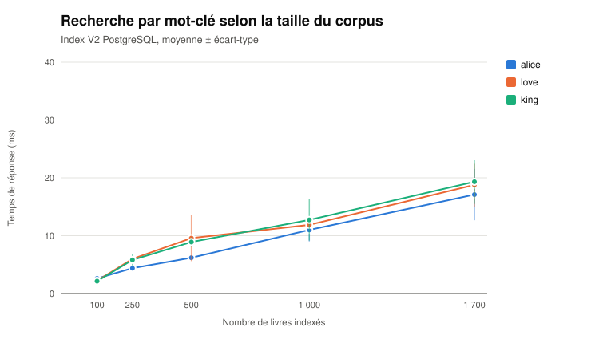
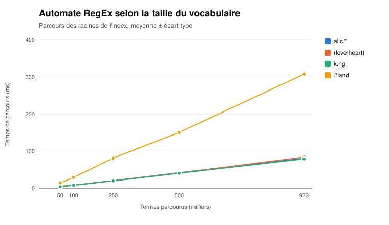
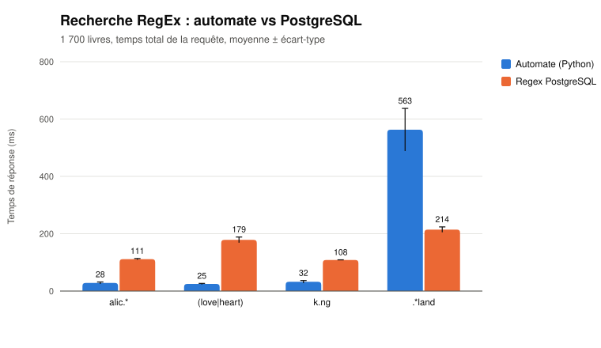
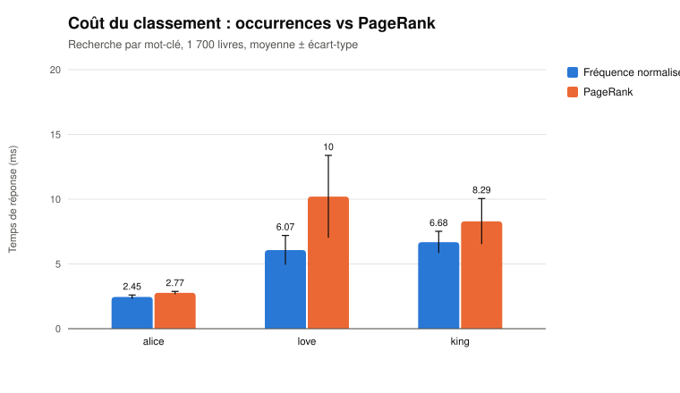
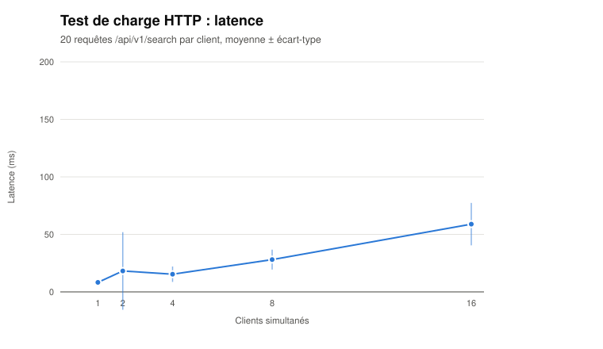
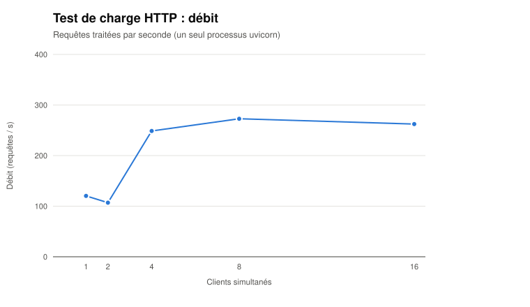

# Évaluation des performances (V2)

Mesures réalisées le 17 novembre 2026 sur l'index V2 (racines + mots vides
filtrés). Données brutes : `docs/benchmarks_v2/*.csv`. Graphiques :
`docs/benchmarks_v2/*.svg`.

## Environnement

- Corpus : 1 700 livres Project Gutenberg, 973 252 termes (racines), 10,7 M d'entrées livre-terme
- Backend : Python 3.12 / FastAPI, un seul processus uvicorn (~140 Mo de mémoire)
- Base : PostgreSQL 16
- Machine : Docker Desktop sur macOS (portable)
- Temps mesurés avec `perf_counter()` côté serveur, après un échauffement.
  Les répétitions sont indiquées pour chaque expérience.

## Reproduire

```bash
docker compose exec backend python -m scripts.benchmark_v2 --out /tmp/bench
docker cp "$(docker compose ps -q backend)":/tmp/bench/. docs/benchmarks_v2/
python3 scripts/plot_benchmark_v2.py docs/benchmarks_v2
```

## 1. Recherche par mot-clé selon la taille du corpus

On restreint la recherche à un échantillon régulier de N livres
(100 → 1 700) ; 15 répétitions par point.



| Livres | alice | love | king |
|---:|---:|---:|---:|
| 100 | 2,4 ms | 2,2 ms | 2,0 ms |
| 500 | 6,5 ms | 8,5 ms | 13,0 ms |
| 1 000 | 11,1 ms | 11,6 ms | 12,6 ms |
| 1 700 | 17,1 ms | 18,8 ms | 19,3 ms |

**Lecture.** Le temps croît à peu près linéairement avec le nombre de livres :
le coût dominant est l'agrégation des entrées (livre, terme) du mot cherché,
dont le nombre est proportionnel au corpus. Même à 1 700 livres, la réponse
reste sous 20 ms. Sans le filtre d'échantillonnage (`IN (...)` de 1 700 id),
la même recherche prend 2 à 7 ms (voir §3) : la contrainte artificielle du
benchmark coûte elle-même une dizaine de millisecondes.

## 2. Automate RegEx selon la taille du vocabulaire

L'automate (Thompson NFA, déterminisé à la volée) est appliqué à chaque racine
de l'index, sans filtre par préfixe. On fait varier le nombre de racines
parcourues ; 5 répétitions.



| Termes parcourus | alic.* | (love\|heart) | k.ng | .*land |
|---:|---:|---:|---:|---:|
| 50 000 | 4 ms | 6 ms | 4 ms | 14 ms |
| 500 000 | 42 ms | 41 ms | 40 ms | 150 ms |
| 973 252 | 81 ms | 84 ms | 79 ms | 308 ms |

**Lecture.** Coût linéaire en taille du vocabulaire. Un motif qui commence par
un caractère précis (`alic.*`, `k.ng`) rejette la plupart des mots dès la
première lettre : ~0,08 µs par racine. Un motif qui commence par `.*` doit lire
chaque mot en entier : ~0,3 µs par racine, soit O(longueur du mot).

Numéroter les états du DFA (un dictionnaire par état au lieu d'une table
indexée par ensembles d'états) a divisé ce temps par 2,4 : 193 ms → 81 ms.

## 3. Recherche RegEx complète : automate vs PostgreSQL

10 répétitions sur le corpus complet. « Automate » = notre moteur sur le
vocabulaire en mémoire ; « PostgreSQL » = opérateur `~*` de la base.



| Motif | Livres | Avant optimisation | Automate (après) | Regex PostgreSQL |
|---|---:|---:|---:|---:|
| alic.* | 391 | 1 237 ms | **28 ± 3 ms** | 111 ± 2 ms |
| (love\|heart) | 1 651 | 1 070 ms | **25 ± 2 ms** | 179 ± 10 ms |
| k.ng | 1 470 | 1 123 ms | **32 ± 4 ms** | 108 ± 1 ms |
| .*land | 1 683 | non mesuré | 563 ± 74 ms | **214 ± 9 ms** |

**Lecture.** Les deux méthodes renvoient exactement les mêmes livres. Trois
optimisations expliquent le gain d'un facteur ~40 sur les trois premiers motifs :

1. **Vocabulaire en mémoire.** Avant, les 973 252 racines étaient transférées
   de PostgreSQL vers Python à chaque requête (~900 ms). Elles sont maintenant
   chargées une fois au démarrage, triées (~80 Mo de mémoire).
2. **Filtre par préfixe littéral.** L'arbre syntaxique donne les préfixes
   possibles (`alic.*` → `alic`, `(love|heart)` → `love`, `heart`, `k.ng` → `k`).
   Une recherche dichotomique dans le vocabulaire trié restreint le parcours
   aux racines candidates : O(log n + candidats) au lieu de O(n).
3. **DFA numéroté** (voir §2) et un seul paramètre tableau pour transmettre
   les racines reconnues à PostgreSQL.

Un motif sans préfixe (`.*land`) impose de parcourir tout le vocabulaire :
c'est le seul cas où l'opérateur de PostgreSQL (écrit en C) reste plus rapide.
Piste : indexer aussi les racines renversées pour traiter les suffixes.

### Coût du classement



| Mot | Fréquence normalisée | PageRank |
|---|---:|---:|
| alice | 2,5 ms | 2,8 ms |
| love | 6,1 ms | 10,2 ms |
| king | 6,7 ms | 8,3 ms |

**Lecture.** Le PageRank est stocké dans la table `book_scores` : le tri est une
jointure et un `ORDER BY` dans PostgreSQL, qui ne renvoie que la page demandée.

### Stockage du graphe : JSON → PostgreSQL

| | Avant (fichier JSON) | Après (tables PostgreSQL) |
|---|---:|---:|
| Taille | 75 Mo | 4,8 Mo |
| Arêtes | 1 120 057 (densité 78 %) | 36 506 (densité 2,5 %) |
| Lecture des scores PageRank | 899 ms (relecture du fichier) | jointure SQL, incluse dans la recherche |
| Suggestions d'un livre | ~1,3 s | 10 ms |
| PageRank max / min | ≈ 9 (quasi uniforme) | ≈ 60 |

L'ancien graphe reliait 78 % des paires de livres : tous les textes anglais
partagent le vocabulaire courant, donc la similarité dépassait presque toujours
le seuil et le PageRank ne distinguait rien. Le nouveau graphe ne compare que le
vocabulaire **discriminant** (racines présentes dans au moins 2 livres et au plus
50 % du corpus), avec le même seuil de 0,20, et garde pour chaque livre ses
5 plus proches voisins. Construction : ~60 s de chargement + ~160 s pour les
1,44 million de comparaisons.

## 4. Test de charge HTTP

N clients simultanés envoient chacun 20 requêtes `/api/v1/search` (mots tirés au
hasard parmi 8). Un seul processus uvicorn, aucune erreur sur 620 requêtes.




| Clients | Débit | Latence moyenne | p95 |
|---:|---:|---:|---:|
| 1 | 120 req/s | 8,3 ms | 9,8 ms |
| 2 | 107 req/s | 18,2 ms | 22,7 ms |
| 4 | 249 req/s | 15,4 ms | 30,1 ms |
| 8 | 273 req/s | 28,1 ms | 43,0 ms |
| 16 | 262 req/s | 58,9 ms | 91,8 ms |

**Lecture.** Le débit plafonne autour de 250-270 requêtes/s à partir de 4 clients :
au-delà, les requêtes attendent leur tour et la latence augmente presque
linéairement avec le nombre de clients (loi de Little). Pour une démonstration
avec quelques appareils, la marge est très large. Pour monter en charge, on
lancerait plusieurs workers uvicorn (`--workers 4`) et on agrandirait le pool
de connexions PostgreSQL.

## Comparaison avec la V1

| | V1 (`PERFORMANCES_P1.md`) | V2 |
|---|---:|---:|
| Termes distincts | 1 000 281 | 973 252 |
| Entrées livre-terme | 15 546 923 | 10 753 306 |
| Mot-clé « love » | 11,2 ms | 6,1 ms |
| Regex PostgreSQL « love\|heart » | 328 ms | 179 ms |
| Regex par automate « love\|heart » | n'existait pas | 25 ms |

Le filtrage des mots vides et la racinisation réduisent l'index de 31 %
et divisent environ par deux le temps des recherches.
