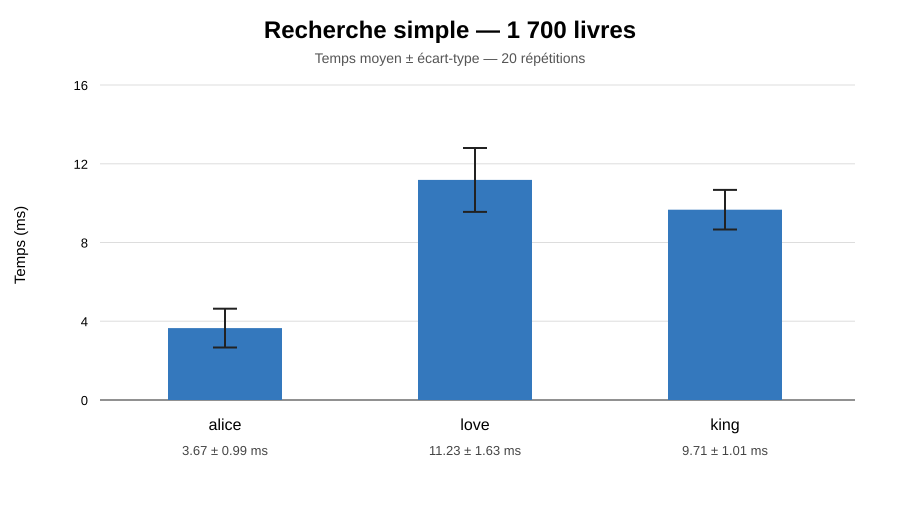
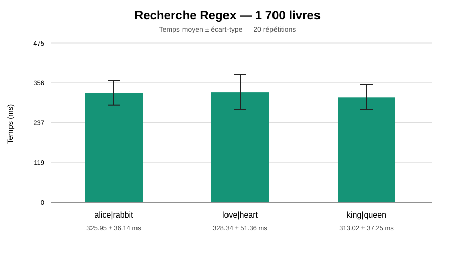

# Évaluation des performances (P1)

## Objectif

Évaluer les temps de recherche simple et de recherche
avancée par expression régulière sur un corpus de
1 700 livres issus de Project Gutenberg.

## Environnement

- Backend : Python / FastAPI
- Stockage : PostgreSQL 16
- Index : index inversé relationnel
- Exécution : Docker Desktop sur macOS
- Corpus : 1 700 livres
- Termes distincts : 1 000 281
- Associations livre-terme : 15 546 923

## Méthodologie

Six requêtes ont été mesurées, chacune 20 fois.

Un échauffement a été effectué avant les mesures.
L'ordre d'exécution des requêtes a été mélangé
de manière déterministe entre les répétitions.

Le chronométrage utilise perf_counter().

Le temps mesuré comprend la requête de comptage
des résultats et la récupération des 20 premiers
résultats classés par fréquence d'occurrences.

Les temps HTTP et de rendu frontend sont exclus.

Les résultats sont exprimés en millisecondes.

## Résultats

| Mode | Requête | Résultats | Moyenne (ms) | Écart-type (ms) |
|---|---|---:|---:|---:|
| Simple | alice | 296 | 3,67 | 0,99 |
| Simple | love | 1 590 | 11,23 | 1,63 |
| Simple | king | 1 428 | 9,71 | 1,01 |
| Regex | alice\|rabbit | 617 | 325,95 | 36,14 |
| Regex | love\|heart | 1 651 | 328,34 | 51,36 |
| Regex | king\|queen | 1 506 | 313,02 | 37,25 |

## Graphiques

### Recherche simple

### Recherche Regex

Les barres représentent les moyennes et les barres
d'erreur représentent plus ou moins un écart-type.

## Analyse

Dans les conditions testées, la recherche simple
présente des temps moyens compris entre 3,67 ms
et 11,23 ms.

La recherche Regex présente des temps moyens
compris entre 313,02 ms et 328,34 ms.

La différence est cohérente avec le fait que la
recherche Regex évalue un motif sur les termes
de l'index, alors que la recherche simple peut
chercher directement des termes déterminés.

Il ne s'agit toutefois pas de requêtes strictement
équivalentes. Les résultats ne permettent donc
pas d'isoler entièrement le coût du moteur Regex.

## Limites

- Les tests sont réalisés sur une seule machine.
- Le corpus complet contient 1 700 livres.
- Les temps HTTP et frontend ne sont pas mesurés.
- Les caches de PostgreSQL peuvent influencer
  les mesures.
- Les essais sur 200, 500 et 1 000 livres
  correspondent à des filtres au sein d'une même
  base de 1 700 livres, et non à des bases
  indépendantes de tailles différentes.

## Perspectives

Compléter l'étude par des bases de tailles
différentes dans un environnement isolé,
puis par des tests de charge HTTP et
une comparaison des classements par
occurrences et par PageRank.
